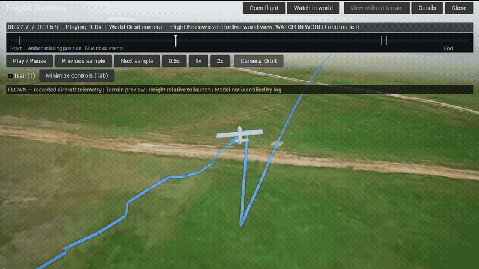
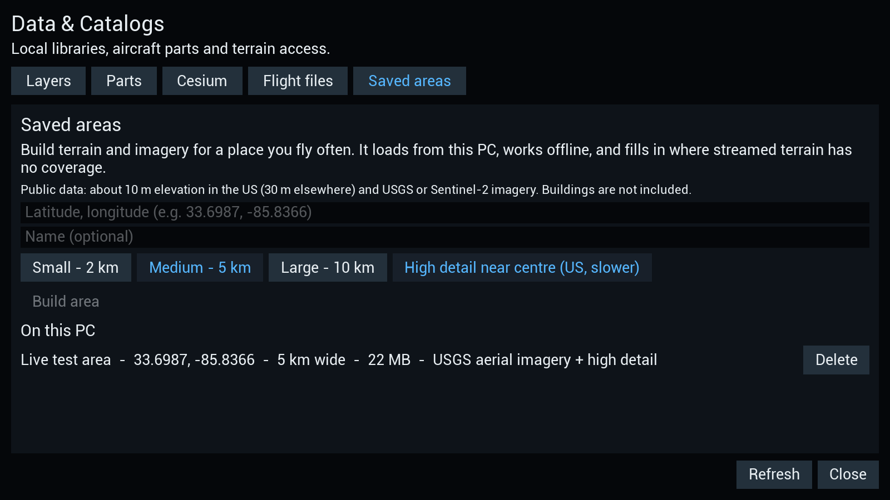
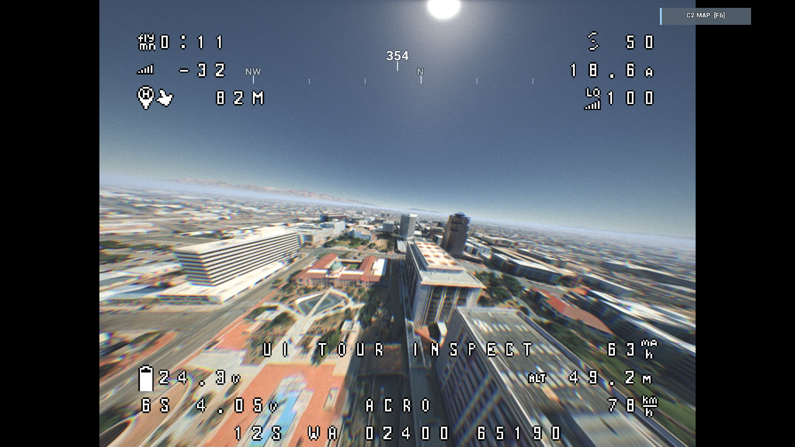
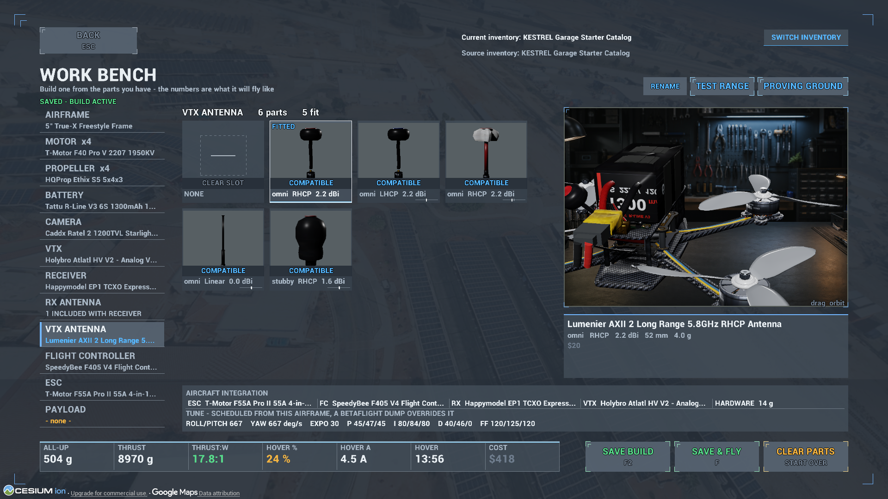

**Build an aircraft. Choose a location. Practise the flight.**

Windows x64 · Alpha · Proprietary software

[Download v0.45.0](https://github.com/nbschultz97/kestrel/releases/tag/v0.45.0-alpha) · [Features](FEATURES.md) · [Changelog](CHANGELOG.md) · [Roadmap](ROADMAP.md)

KESTREL is an Unreal Engine small-UAS flight simulator with a parts-based Work
Bench, saved aircraft, FPV flight and Flight Review. This repository distributes
the public Windows alpha; it does not distribute the private source repository.

Previously authorized user-recorded Flight Review footage from v0.44; retained unchanged.

## KESTREL v0.45.0 - Flight Lab, saved areas and Mission Builder

Package version: `v0.45.0-alpha`. Release tag: `v0.45.0-alpha`.
See the [release page](https://github.com/nbschultz97/kestrel/releases/tag/v0.45.0-alpha) for the exact source revision, archive checksum,
package checks and remaining acceptance limits.

- **Flight Lab** is one place to replay recorded flights and run simulations.
  Simulation runs a local Lua script, unchanged, in native ArduPlane SITL over
  streamed terrain with live firmware messages and telemetry. You supply the
  SITL executable; scripts and results stay on your computer.
- **Saved areas** (Data & Catalogs) build offline terrain and imagery for any
  location from public data: about 10 m elevation in the US (30 m elsewhere),
  USGS or Sentinel-2 imagery, optional 0.6 m US detail near the centre and
  OpenStreetMap building footprints where mapped. They load without a
  connection and fill in where streamed terrain has no coverage.
- **No more flat floor**: when nothing streams under the launch point, KESTREL
  builds a small local area on the spot (usually under a minute) and flies there.
- **Mission Builder** keeps everything in a mission you edit and saves back to
  the file you opened. Undo (Ctrl+Z), duplicate (Ctrl+D), stacked selection and a
  briefing field. Placed jammers emit, and a strike destroys a jammer inside its
  blast. Items with no purpose were retired from the palette; old missions load.
- New models for objectives, OPFOR target vehicles with destroyed versions,
  civilian cars, and SOF and support vehicles.

Limits: saved-area imagery is public data and looks soft at very low altitude;
building footprints are visual only, with estimated heights where OpenStreetMap
has none. Two-PC LAN, full input rebinding and calibrated aircraft performance
remain incomplete. Windows binaries are unsigned.

Earlier features and release evidence remain in [CHANGELOG.md](CHANGELOG.md).
[FEATURES.md](FEATURES.md) describes scope; [ROADMAP.md](ROADMAP.md) tracks unfinished work.

## Download and start

GitHub downloads are available without signing in. The Rotopter host currently
requires a signed-in account; both packages use the GitHub updater channel.

1. [Download KESTREL-alpha-win64.zip](https://github.com/nbschultz97/kestrel/releases/download/v0.45.0-alpha/KESTREL-alpha-win64.zip). The same release is available on
   [GitHub](https://github.com/nbschultz97/kestrel/releases/tag/v0.45.0-alpha)
   and [Rotopter](https://git.rotopter.com/nschultz/Kestral/releases/tag/v0.45.0-alpha).
2. Check SHA-256 against the release page or attached checksum, then extract the
   entire ZIP into a new folder. Do not mix versions or run from inside the ZIP.
3. Start **KESTREL.exe**, the player-facing launcher. Keep the extracted tree
   intact; the nested game executable is not the normal entry point.
4. Check input source, calibration and axis directions, then save. Choose a
   starter aircraft in Work Bench and review controls before Free Flight.

Windows binaries are unsigned. Windows or organization policy may block them.
Checksums verify archive identity; they are not publisher signatures.
Windows x64 and a modern discrete GPU are expected; exact minimum hardware
performance and compatibility with every USB radio are not certified.

## Updates and local data

The current update channel serves **v0.45.0-alpha**. Installed builds are
offered it on their next launch; the release page records the upgrade checks
that have passed. This does not certify every user profile or Windows policy.

The launcher checks the official GitHub-hosted update manifest. GitHub and
Rotopter packages use the same updater channel. A versioned release link and
GitHub Latest/default-updater promotion are separate steps: the release page
records which upgrade checks have passed. The launcher downloads the version
selected by the manifest and verifies its size and SHA-256 before installation.
A published ZIP alone does not prove that an installed upgrade passed.

Back up local settings and aircraft before updating. Local profiles and reports
normally live under `Documents/KESTREL`; do not publish them accidentally.
The public build includes the approved public terrain configuration. Streaming
requires Internet access, provider availability, coverage and loading time.
The offline Test Range is not an offline copy of the globe.

## Known limits

- Full rebinding and physical two-PC LAN acceptance remain incomplete;
  experimental LAN is included.
- Some dense settings rows still shorten long text. The character/equipment and
  vehicle presentation is not a complete diversity or exact-hardware overhaul.
- Raw GIS and point-cloud inputs need conversion; merely adding a reference
  does not render customer 3D scenery. Customer layers, recordings and private
  parts libraries are not bundled.
- Configured weather is not live weather. Online street-address/POI search and
  TAK/live-C2 integration are not included.
- This alpha does not establish calibrated real-aircraft behavior, universal
  component fit, whole-roadmap completion or production certification.

## Historical gameplay images

These existing images are from v0.42.11, not new v0.45.0 acceptance captures.

Actual in-engine footage captured by a virtual pilot, not a manual-flight test.

Inspect fitted components and saved aircraft. This older view does not establish
real-world component fit or show the latest interface.

## Reports, privacy and credits

No live reporting endpoint is bundled. Reports remain local, normally under
`Documents/KESTREL/reports`. Review logs and screenshots before sharing: they may
contain personal paths or locations. [Report issues](https://github.com/nbschultz97/kestrel/issues)
with version, reproduction steps, expected and actual results. Never post tokens.

KESTREL is not open source. See the [License](LICENSE.txt) and shipped
third-party notices. Unreal Engine, Cesium and imagery, map, font, audio and asset
providers retain their rights and attribution. For licensing contact
[Ceradon Systems](mailto:nbschultz97@gmail.com). Older notes: [RELEASE_NOTES.md](RELEASE_NOTES.md).
