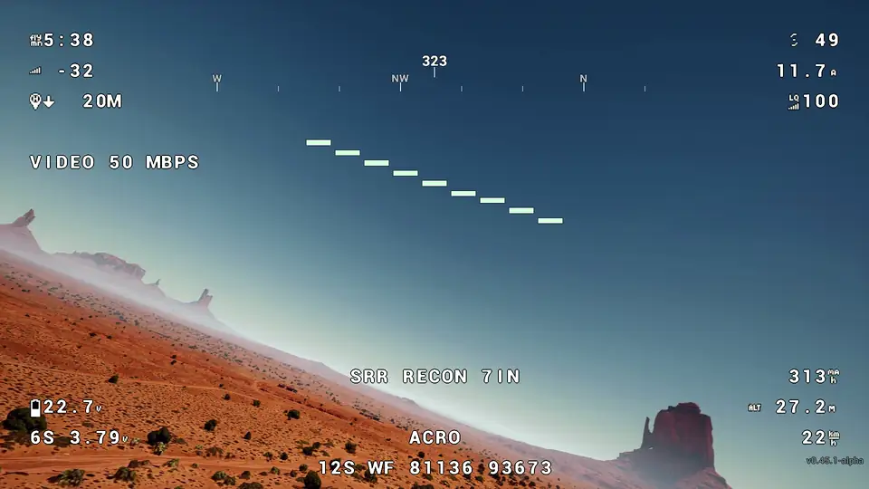
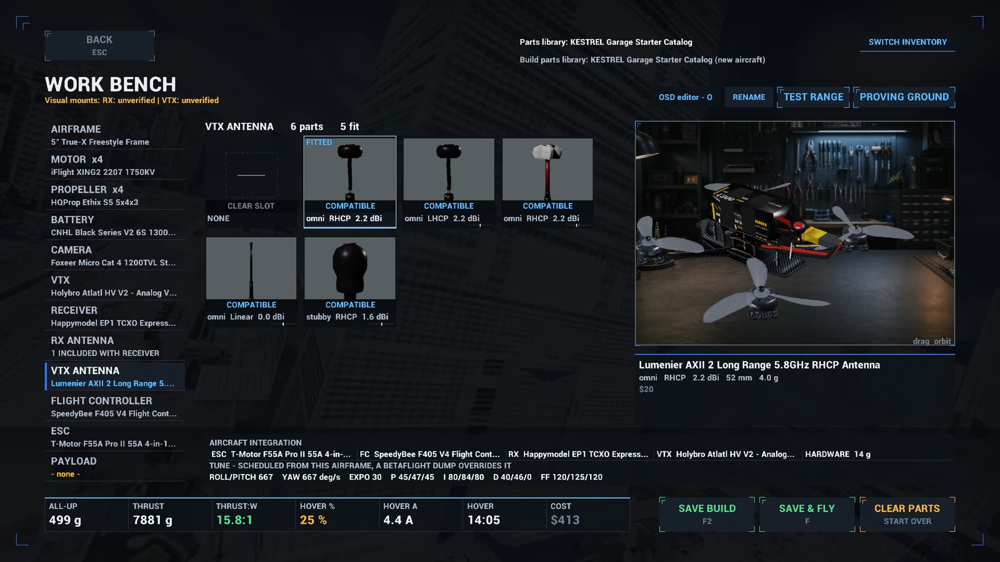
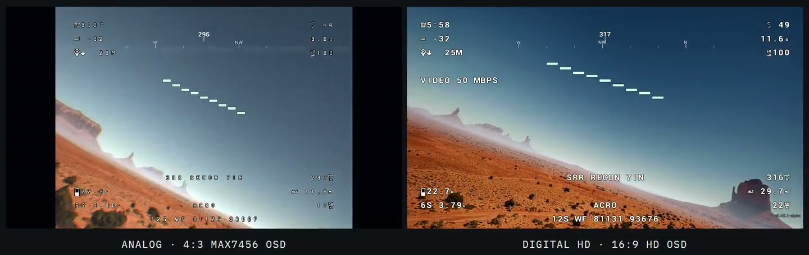
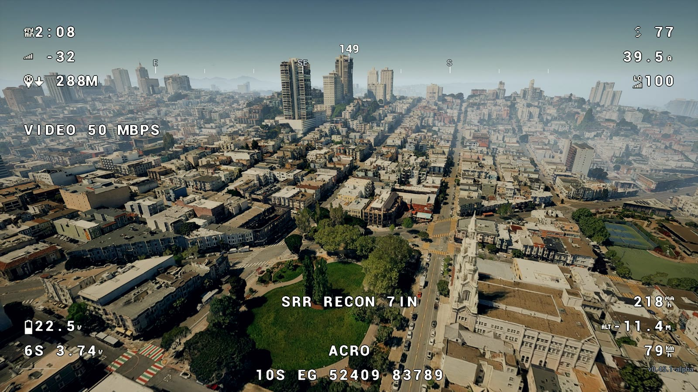
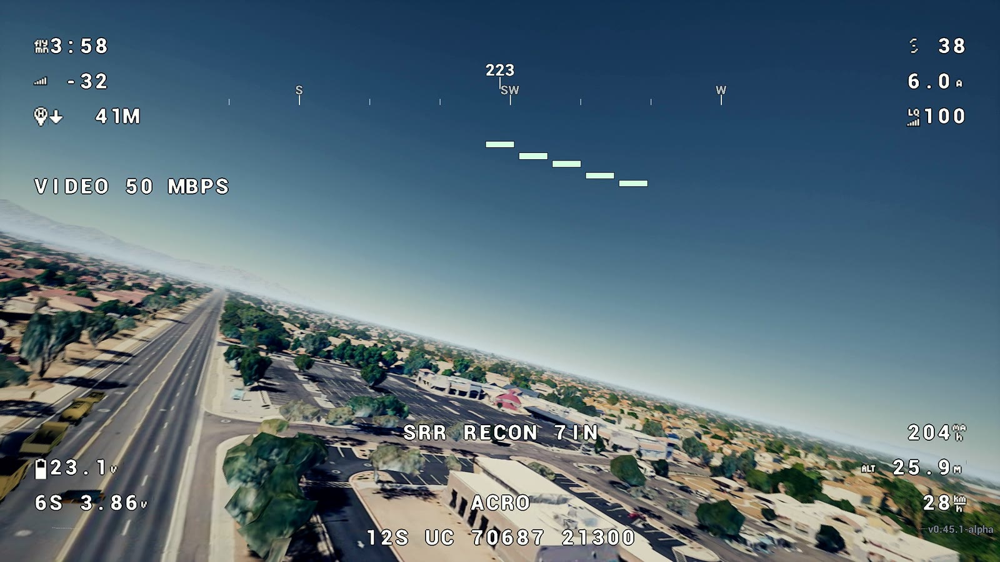
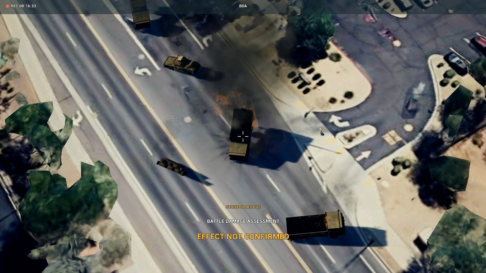
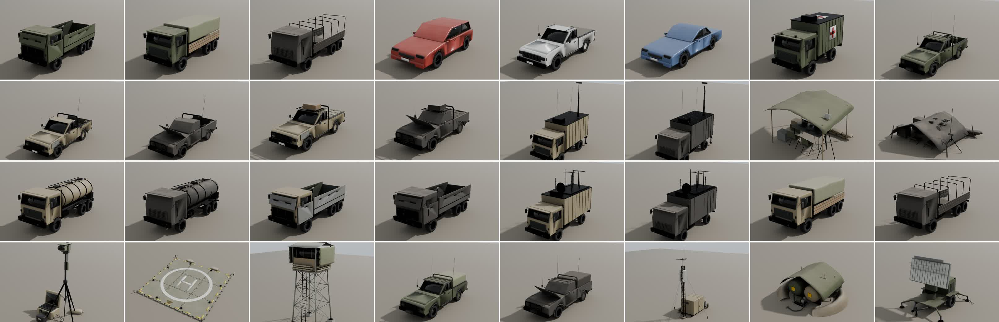
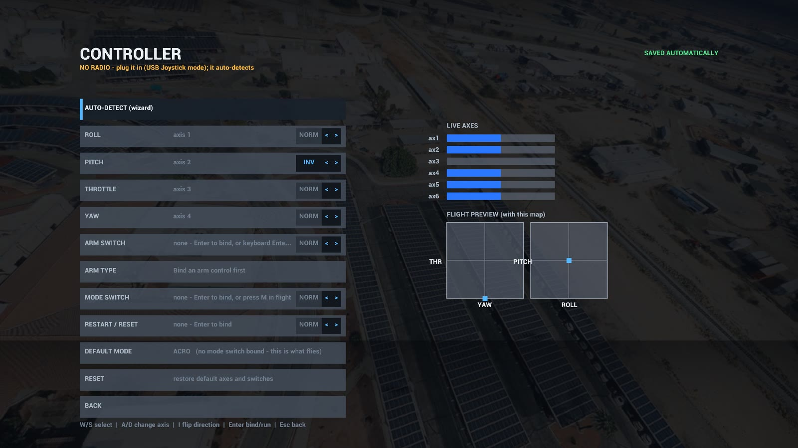
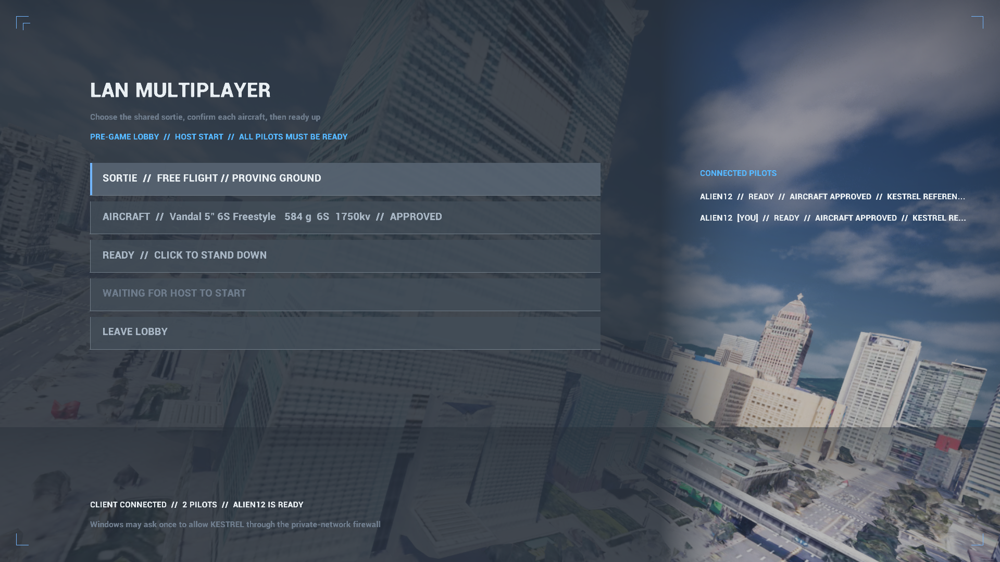

<picture>
  <source media="(prefers-color-scheme: dark)" srcset="media/brand/kestrel-lockup-instrument.svg">
  <source media="(prefers-color-scheme: light)" srcset="media/brand/kestrel-lockup-graphite.svg">
  
</picture>

**Build the aircraft from real parts. Pick any place on Earth. Fly it first.**

Windows x64 · Free public alpha · Proprietary software

[Download](https://github.com/nbschultz97/kestrel/releases/latest) · [Features](FEATURES.md) · [Changelog](CHANGELOG.md) · [Roadmap](ROADMAP.md)

## What KESTREL is

KESTREL is a small-UAS and FPV training simulator that flies over real-world
terrain. You build an aircraft on the Work Bench from real catalog parts, and
the flight model comes from those parts: mass, motors, props and battery. So a
5-inch quad and a 13-inch heavy-lifter fly differently, and they run out of
battery differently. Then you pick a place, streamed in photoreal 3D where
coverage exists, and fly a free flight or a mission. You get a record of the
flight at the end.

That is the loop: **configure a specific aircraft, fly that exact aircraft on a
real task, and get a record out the other end.** It is built in Unreal Engine 5
and ships as one Windows download. You don't need an engine install or an
account.

Monument Valley, westbound at about 50 m. KESTREL's virtual pilot flies an authored line under the real flight model. Recorded at 1920x1080 in the v0.45.1 test build, whose HD OSD ships in v0.46.

## Feature tour

### Work Bench: build the real aircraft

Fit frames, motors, props, batteries, ESCs, flight controllers, cameras, video
transmitters and receivers from a parts catalog. Each part is checked for
compatibility, and the bench predicts thrust-to-weight, hover throttle and
endurance before you fly. Builds save, rename, duplicate and reopen. Parts
libraries import and export as JSON or XLSX. **New in v0.46:** a fiber reel
slot with 5, 10 and 20 km reels. Bigger reels need bigger airframes (7", 10" and
13" props).

### Flight: it flies like the build

- Betaflight-style rates and PID control, with import of supported Betaflight
  diff settings. It is not a complete firmware emulator.
- ACRO, ANGLE and HORIZON modes, FPV and line-of-sight views.
- Battery discharge and voltage sag under load, motor response, wind that acts
  on airspeed, and collision damage.
- **Analog or HD goggles.** Digital air units get the HD goggle OSD: the full
  16:9 picture, a 53x20 grid and smooth glyphs. Analog cameras keep the 4:3
  MAX7456 look. A lost video feed breaks up the way goggles do. An OSD layout
  editor moves the elements, including the horizon and compass bar.

### World: fly the real place

- Search a city or enter coordinates, place the launch pin, set the time and
  the weather. The sun is placed for the site and date.
- Photoreal 3D terrain streams where the provider has coverage, and the world
  sits on true north. Where nothing streams, KESTREL builds a small local area
  on the spot instead of a flat floor.
- **Saved areas** build offline terrain for a 2, 5 or 10 km area from public
  data: about 10 m elevation in the US (30 m elsewhere), USGS or Sentinel-2
  imagery and OpenStreetMap buildings. Since v0.46 they also have trees, pitched
  roofs, building collision and water. If you land on water, you ditch.

### RF and EW

- The video and control link depend on distance and on line of sight from
  the pilot's eyes through the terrain and buildings. Fly behind a ridge at range
  and the picture breaks up, then the link drops and the aircraft goes to
  failsafe.
- Hostile jammers placed in a mission really emit, and a strike inside the blast
  takes one out.
- **Predicted RF coverage** on the map and the loading map, from public
  elevation data. It is a prediction, not a measurement.
- **Fiber reels (new in v0.46).** While the fiber is whole the link is perfect: any
  range, behind any terrain, through any jammer. The reel spends the route you
  actually fly. The fiber parts if the reel runs out, if you hold a speed above
  its payout limit, or on a hard wrap round an edge. When it parts, the
  aircraft goes to failsafe. The OSD shows fiber left (`FIB 7.4K`) and flashes
  FIBER CUT.

### Missions: build, brief, fly

Mission Builder places targets, jammers and objectives over a real area, writes
the brief, and saves back to the same mission file, with undo and duplicate.
There are 32 mission models: seven OPFOR target vehicles, each with a destroyed
version, plus an FPV drone-team position, a radar, an EW mast, a fuel point, and
civilian, SOF and support vehicles. Wheeled vehicles stay on drivable roads.
Fly recon, ISR overwatch or a strike run, and the Records page keeps the
result.

| | |
|---|---|
|  |  |
| Recon pass on the COLUMN HALT demo mission | Overhead ISR after the strike. The banner reads EFFECT NOT CONFIRMED. |

### Flight Review and Flight Lab

- Replay ArduPilot DataFlash logs and flight files in 3D over the streamed
  terrain, with chase, orbit, FPV-at-recorded-attitude and free cameras.
- **New in v0.46:** a multi-log timeline puts several flights on one UTC clock,
  with a vehicle selector. Attitude-only logs open, and KESTREL never invents
  attitude a log does not have. A converter turns a Betaflight blackbox log
  into a flight KESTREL can open.
- Flight Lab runs a Lua script, unchanged, in ArduPlane SITL over real terrain,
  with live firmware messages and telemetry. You supply the SITL executable.
  Scripts, logs and results stay on your computer.

### Controllers

Keyboard, gamepad or an RC radio in USB-joystick mode. Channels CH1-CH8 are
numbered the way your radio numbers them, so switches on 7 and 8 work.
Stick-end calibration lets a throttle that rests above zero arm. Bindings cover
every flight control, and the reset switch can't fire in flight by accident.
**Settings > Controller > DIAGNOSTICS** shows every channel and switch the game
sees, with plain findings and a COPY REPORT button.

### LAN multiplayer (experimental)

Host or join on one network, approve each aircraft, ready up and fly the same
sortie. It passes a one-PC, two-process test. Play across two physical PCs is
not fully tested yet.

## Latest release: v0.46.0

Fiber-optic reels, the HD goggle OSD, predicted RF coverage, a true-north
photoreal world, saved areas with trees, roofs and water, a multi-log Flight
Review timeline, the Betaflight blackbox converter, and the radio fixes from the
unreleased v0.45.1 (CH7/CH8, stick-end calibration, no disarm on a brief radio
dropout, controller diagnostics). The KESTREL logo is now the stoop-chevron mark
in the game too.

Full notes, checksums and test status are on the
[v0.46.0 release page](https://github.com/nbschultz97/kestrel/releases/tag/v0.46.0-alpha).
Older versions are in [CHANGELOG.md](CHANGELOG.md).

## Download and start

1. [Download KESTREL-alpha-win64.zip](https://github.com/nbschultz97/kestrel/releases/latest/download/KESTREL-alpha-win64.zip)
   (about 1.1 GB) from the [latest release](https://github.com/nbschultz97/kestrel/releases/latest).
   No sign-in is needed.
2. Check the SHA-256 against the release page, then extract the whole ZIP into a
   new folder. Don't run it from inside the ZIP or mix versions.
3. Start **KESTREL.exe**. It is the launcher and updater: it checks the official
   update manifest, verifies a new build's size and SHA-256 before installing,
   and starts the game.
4. Open **Settings > Controller**, calibrate your input and check the axis
   directions. Pick a starter aircraft on the Work Bench, then choose
   **Free Flight**.

Settings, aircraft, records and crash reports live in `Documents\KESTREL`.
Review them before sharing, because they can contain paths and locations.

## System requirements

These are guidance figures, not a certified minimum.

| | Guidance |
|---|---|
| OS | Windows 10 or 11, 64-bit |
| GPU | A modern discrete DirectX 12 GPU. Integrated graphics are not expected to run acceptably. |
| RAM | 16 GB recommended |
| Disk | About 1.1 GB to download and about 2.1 GB extracted |
| Network | Internet for streamed photoreal terrain. Saved areas work offline. |
| Input | RC radio in USB-joystick mode, gamepad or keyboard |

## Honest limits

- **The Windows binaries are unsigned.** SmartScreen may warn, and Smart App
  Control or organization policy may block them. A checksum verifies the
  archive. It is not a publisher signature.
- **Terrain coverage is partial.** Photoreal 3D depends on the provider's
  coverage, your connection and loading time. Detailed buildings are not
  everywhere. Saved-area imagery is public data and looks soft at very low
  altitude.
- **The flight model is not validated against real flights.** It is fitted to
  published thrust-stand and wind-tunnel data. A good simulated flight is not
  proof of how a real aircraft will perform.
- **Fiber reels** have not been flown by a person in the v0.46 package. Payout
  and snag limits are tuning values, not published figures. Crossing your own
  fiber, rotor strike on the fiber and wind drift are not modelled. Other LAN
  players don't see your strand.
- **Radios:** only the RadioMaster Pocket (ELRS, USB joystick mode) is verified
  on real hardware. Keys held by menus (C, F, P, T, U, Y and a few others) can't
  be bound to flight controls yet.
- **Not included:** live weather, online street-address search, TAK or live C2
  integration, and two-PC LAN acceptance.

[ROADMAP.md](ROADMAP.md) tracks unfinished work, and [FEATURES.md](FEATURES.md)
describes scope and evidence in detail.

## Reports, privacy and credits

There is no live reporting endpoint. Crash reports stay local under
`Documents\KESTREL\reports`. [Report issues](https://github.com/nbschultz97/kestrel/issues)
with the version, the steps to reproduce, and what you expected and saw. Never
post tokens.

Unreal Engine, Cesium, and the imagery, map, font, audio and asset providers
keep their rights and attribution. The full notices ship with the game.

## License

KESTREL is proprietary software, not open source. It is free for U.S.
Government personnel and contractors supporting a U.S. Government activity, and
for personal use, under the [KESTREL Evaluation License](LICENSE.txt). For other
licensing, contact [Ceradon Systems](mailto:nbschultz97@gmail.com).
